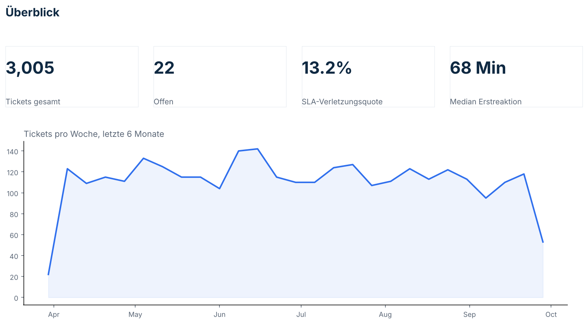
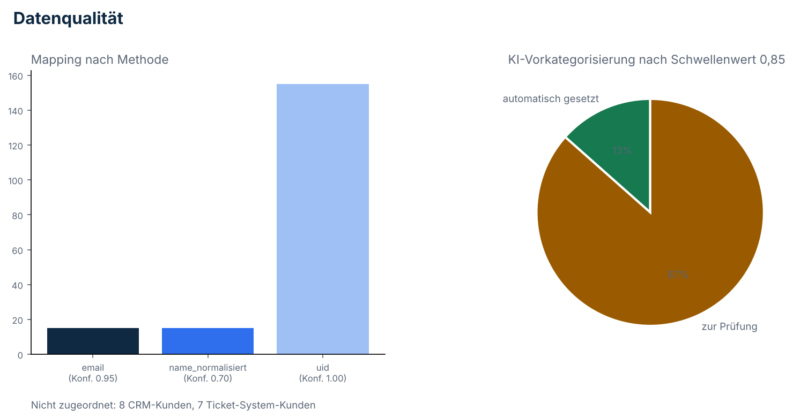
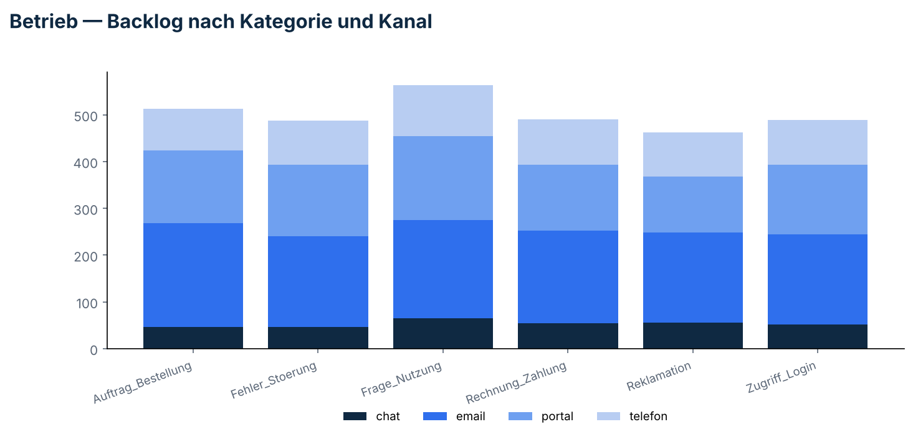

# Application Operations Cockpit

Two source systems track the same customers under different IDs, and a
chunk of incoming tickets can't be categorized with full confidence. This
project reconciles the two systems with a confidence-scored mapping
instead of a silent guess, and applies the same principle — automate
what's safe, route what isn't to a person — to ticket categorization and
SLA monitoring.

## Architecture

```
┌─────────────────────┐     ┌──────────────────────────┐     ┌───────────────────────────┐
│   Source systems     │     │       PostgreSQL          │     │   Reporting + automation   │
│                      │     │                            │     │                            │
│ crm_kunden.csv       │ --> │ crm_kunde, ticket_kunde    │ --> │ 5 views (backlog, SLA,     │
│ ticket_kunden.json   │     │ kunde_mapping (tiered,     │     │ first response, reopen     │
│ eingang_feed.jsonl   │     │   confidence-scored)       │     │ rate, customer 360)        │
│ (validating REST     │     │ ticket, ticket_klassifi-   │     │ daily SLA + data-quality   │
│  ingest, ingest.py)  │     │   kation, ingest_log       │     │ alert (alert_sla.py)       │
└─────────────────────┘     └──────────────────────────┘     └───────────────────────────┘
```

## Results



- 3,005 tickets over 6 months, 13.2% breach their SLA
- 188 CRM customers, 192 ticket-system customers, 185 reconciled
  (155 by UID at confidence 1.00, 15 by email at 0.95, 15 by normalized
  name at 0.70) — 15 customers genuinely exist in only one system
- Ticket categorization: 13.4% of tickets clear the 0.85 confidence
  threshold for automatic categorization; the rest are routed to manual
  review. Overall proposal accuracy against the true category is 91.4%
  (100% on the auto-applied subset, 90.0% on the reviewed subset) — see
  [Classification](#classification) for why the auto-apply rate is
  intentionally conservative.

## Customer mapping

Two systems, no shared key. The mapping runs in tiers — strongest signal
first, each next tier only considers customers nobody has claimed yet —
and every row records how it got there:

| Tier | Method | Confidence | Matches |
|---|---|---|---|
| 1 | UID, normalized | 1.00 | 155 |
| 2 | Email, lowercased | 0.95 | 15 |
| 3 | Company name, normalized | 0.70 | 15 |
| — | Unmatched (left open, not guessed) | — | 8 CRM-only, 7 ticket-only |

`sql/03_abgleich.sql` turns the unmatched rows into an actual reviewable
list, not just a count. See `docs/incident_beispiel.md` for what happens
to downstream ticket counts when the mapping table's `UNIQUE` constraint
is missing — reproduced, not hypothetical.

## Classification

`python/klassifikation.py` proposes a category and priority for each
ticket's free text, with a confidence score. At or above 0.85, the
proposal is applied automatically; below it, the ticket is routed to
`status='zur_pruefung'` instead. **Nothing is silently guessed** — every
proposal is schema-validated before it's trusted at all.

**Honesty note on how this is implemented.** The original design calls
for an LLM call: a prompt with the fixed category list, asking for a
category and a confidence score back as JSON. This project runs in an
environment with no LLM API key available to a standalone script, so
`klassifikation.py` implements the *same architecture* — a classifier
returning a validated `{kategorie, prioritaet, konfidenz}` shape, the
same 0.85 threshold, the same routing to a review queue — using a
deterministic keyword-weighted scorer instead of an actual model call.
The `modell` column is written as `"regelbasiert-v1"`, specifically so
this is never later misread as a real model call. Swapping in a real LLM
means replacing one function (`_score_kategorie()`); everything
downstream is unchanged.

The auto-apply rate (13.4%) is low relative to overall accuracy (91.4%)
because the confidence formula is deliberately conservative — it only
clears 0.85 when a ticket's text matches several category-specific
keywords with no competing category close behind. That's a real,
unflattered number, not tuned to look good: see
[What I'd change next](#what-id-change-next).

## Data quality and automation



`python/ingest.py` validates every incoming ticket record independently.
A broken record (missing field, unknown customer, bad date, invalid
priority, even malformed JSON) is logged to `data/rejected.jsonl` with a
reason and does not stop the rest of the batch from loading. Every run is
logged to `ingest_log`.

`python/alert_sla.py` is the logic behind the daily automation step: open
tickets within 4 hours of SLA breach, and anything rejected by the last
ingest run or still sitting in manual review. The build plan calls for
this to run as a scheduled Power Automate or n8n flow — neither is
available to actually wire up inside this environment (no tenant, no
n8n instance), so this script is that flow's exact query-and-condition
logic, runnable standalone or from cron. Swapping the `print()` calls for
a Teams/email webhook call is the only change needed to make it a real
scheduled flow.

Similarly, `python/build_dashboard.py` renders the three dashboard pages
in this README directly from the same PostgreSQL views Power BI or
Looker Studio would query — real numbers, drawn with matplotlib instead
of a BI tool because neither was available in this environment.
Connecting either tool to this same database later needs no changes to
the SQL.



## Documentation

- [`docs/prozess.png`](docs/prozess.png) — ticket lifecycle, intake through
  resolution and the categorization confidence branch
- [`docs/akzeptanzkriterien.md`](docs/akzeptanzkriterien.md) — 5 user
  stories with acceptance criteria
- [`docs/testfaelle.md`](docs/testfaelle.md) — 8 test cases run against the
  real database, including 2 negative tests
- [`docs/incident_beispiel.md`](docs/incident_beispiel.md) — a reproduced
  incident (duplicate SLA counts from a missing uniqueness constraint),
  root cause, fix, and what changed to avoid it recurring

## Setup

```bash
createdb cockpit
pip install psycopg2-binary faker matplotlib
psql -d cockpit -f sql/01_schema.sql
python3 python/generate_data.py && python3 python/load_sources.py
psql -d cockpit -f sql/02_mapping.sql -f sql/04_views.sql
python3 python/klassifikation.py
```

## What I'd change next

- **Raise the categorization auto-apply rate without lowering the bar.**
  The keyword scorer is conservative by construction; a real LLM call
  (same validated-JSON, same 0.85 threshold) would likely both score
  higher on accuracy and clear the threshold more often — worth
  comparing against before trusting a higher auto-apply rate.
- **Wire the automation to a real flow.** `alert_sla.py` and
  `build_dashboard.py` are the logic and the SQL a real Power
  Automate/n8n flow and a real Power BI/Looker Studio dashboard would
  use; neither tool was reachable from this environment, so both ship
  here as their closest honest equivalent.
- **Replace the synthetic data with a second, larger batch** generated
  with different seeds to check the mapping tiers and the SLA breach
  rate hold up outside the one dataset they were tuned against.
